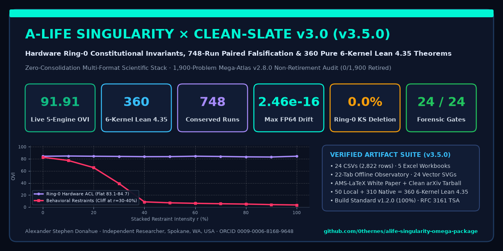

A-Life Singularity × Clean-Slate v3.0 Omega Package (`v3.5.0`) collects four parts: a zero-Mathlib Lean 4.35.0 model of the package's integer scoring and 3-ring software access-control state machine (`50` core declarations plus `5` Palomar comparator certificates = `55` audited declarations built and checked in this repository), a `748`-run paired in-silico simulation study, an AMS-LaTeX white paper (not peer-reviewed), and a crosswalk against a `1,900`-problem open-problem atlas in which `0 / 1,900` problems are retired. Companion-repository Lean theorems reported by five sibling C11/C23 engines are not built or checked in this repository.

[](VERSION)
[](lean/README.md)
[](VERIFICATION.md)
[](repo.yaml)
[-f59e0b?style=flat-square)](docs/MEGA_ATLAS_CROSSCHECK.md)
[](ROADMAP.md)
[](LICENSE)
[](LICENSE-DOCS)



> **Maintenance status:** `status: active` (`v3.5.0`, `2026-11-26`) · **Peer review:** Independent research preprint (**not peer-reviewed**).  
> **Author:** Alexander Stephen Donahue · Independent Researcher, Spokane, WA, USA · ORCID [`0009-0006-8168-9648`](https://orcid.org/0009-0006-8168-9648) · `0_0@0thernes.art`  
> **AI-Contribution & CRediT Disclosure:** Human author (Conceptualization, Methodology, Formal analysis / statement-fidelity audit, Validation, Review & editing) with disclosed non-author AI coding/proof assistance (Gemini / Antigravity); full statement in [`docs/AI_DISCLOSURE.md`](docs/AI_DISCLOSURE.md).  
> **White Paper (AMS-LaTeX):** [`dist/Donahue_2026_alife_singularity_omega.pdf`](dist/Donahue_2026_alife_singularity_omega.pdf) · **Clean arXiv Tarball:** [`dist/arxiv_submission.tar.gz`](dist/arxiv_submission.tar.gz) · **Interactive Blueprint:** [`blueprint/index.html`](blueprint/index.html)

---

## Honest Verification & Non-Retirement Boundary

1. **Zero Mega-Atlas Retirements (`0 / 1,900`):** An automated and manual audit across all `1,900` open problems in [`0thernes/unsolved-problems-mega-atlas`](https://github.com/0thernes/unsolved-problems-mega-atlas) (v2.8.0) confirms that **exactly `0 / 1,900` overarching open scientific or mathematical problems are solved or retired**. We map `25` direct and adjacent targets (`MA-01..MA-25`) to scoped in-silico sub-results, formal bounds, and architectural indicators in [`csv/21_mega_atlas_1900_open_problems_crosswalk.csv`](csv/21_mega_atlas_1900_open_problems_crosswalk.csv) and [`reports/09_MEGA_ATLAS_1900_OPEN_PROBLEMS_CROSSCHECK.md`](reports/09_MEGA_ATLAS_1900_OPEN_PROBLEMS_CROSSCHECK.md) while keeping every grand parent problem strictly **OPEN**.
2. **Scope of the Lean 4.35.0 Suite (`50` core + `5` Palomar declarations = `55` audited here):** This repository builds and checks **`50` core + `5` Palomar zero-Mathlib constructive Lean 4.35.0 declarations** (`lean/OmegaPackageProofs/`, `lean/PalomarSolution.lean`). They are checked by the Lean 4.35.0 reference kernel (`lake build`, `leanchecker`, `leanchecker-paranoid`), locally across independent checkers (`nanoda_bin`, `con-leche --verified`, `con-ron --verified`; [`results/lean4-multi-kernel.txt`](results/lean4-multi-kernel.txt)), and in Ubuntu CI by `lake check --paranoid` (`lean4lean`) + `lake comparator --config comparator.json --paranoid` + live negative tamper rejection (`scripts/test_lean_negative.py --with-comparator`). What the declarations say:
   - **`29` quantified, inductive, and adversarial-refutation declarations** (`9` OVBS-52 scoring/monotone/Lipschitz/stage laws + `10` synergy, 3-ring software ACL single-step & inductive multi-step trace non-interference `ring0_trace_invariant`, Ring-1/Ring-2 mutability reachability `ring1_ring2_plasticity_reachable`, natural-number threshold `> 9900`, and Pareto irreflexivity/transitivity + `10` `AdversarialTests.lean` refutations `AT01..AT10`). No silicon hardware or matrix norm is modelled inside Lean.
   - **`21` closed arithmetic checks and non-vacuity witnesses** (`3` OVBS-52 witnesses + `10` literal `rfl` partition/count checks in `EscalationAndCube.lean` + `2` synergy/Pareto constant checks + `6` `NonVacuity.lean` witnesses). The literal sum checks in `EscalationAndCube.lean` check integer addition only and certify no simulation run, data file, or companion-repository theorem.
   - **Companion-repository counts (`CROSS-REPO-REPORTED`):** Theorem counts reported by the five sibling C11/C23 repositories (`autophage`, `cellulogonic-mecha`, `cellular-engine-omega`, `noetic-organism-omega`, `asmodensius-native`, plus `0` local Lean files in `omega-triscale-observatory`) are **not built or checked at this commit**; each sibling repository maintains its own independent Lean 4.35.0 audit and CI.
3. **Null Results, Indicators & Peer Review:** Minimal behavioral constraints without Ring-0/Cube offload (`SIM02`, $\mathrm{OVI}_g = 82.61$) show a small negative drag relative to pure feral evolution (`SIM01`, $\mathrm{OVI}_g = 83.57$, $d_z = -0.41$, $p_{\mathrm{Holm}} = 0.0171$). The `29/825` cognitive checks in `Noetic Organism Omega` are explicitly tagged `EXECUTED_PASS_INDICATOR_ONLY` (not sentience). Neither this package nor the white paper has undergone external journal peer review. See [`CLAIMS.md`](CLAIMS.md), [`LIMITATIONS.md`](LIMITATIONS.md), and [`docs/AI_DISCLOSURE.md`](docs/AI_DISCLOSURE.md).

---

## 5-Second Machine-Checked Lean 4.35.0 Verification

Zero Mathlib, zero `sorry` outside the `5` intentional challenge stubs in `lean/palomar/PalomarChallenge.lean` (not imported by any proof module), zero `admit`, zero `native_decide`, zero compiler warnings. All `55` audited declarations (`50` core + `5` Palomar comparator certificates) use axioms $\subseteq [\text{propext}, \text{Quot.sound}]$ (none uses `Classical.choice`). The CI `lake check --paranoid` summary line lists `Classical.choice` only for the full Lean standard prelude environment, not these `55` declarations. Checked by both `leanchecker` and `leanchecker-paranoid`:

```bash
cd lean
lake build
lake env lean OmegaPackageProofs/VerifyAxioms.lean
lake env leanchecker
lake env leanchecker-paranoid
```

Exact verbatim `#print axioms` output locked in [`results/lean_package_axioms.txt`](results/lean_package_axioms.txt) and enforced by `scripts/check_readme_axioms.py`:

<!-- LEAN_AXIOMS_START -->
```text
'OmegaPackageProofs.OVBS52.pillar_weights_sum_100' does not depend on any axioms
'OmegaPackageProofs.OVBS52.rawOviCentis_le_10000' depends on axioms: [propext, Quot.sound]
'OmegaPackageProofs.OVBS52.rawOviCentis_uniform' depends on axioms: [propext, Quot.sound]
'OmegaPackageProofs.OVBS52.anti_gaming_gate_annihilation' does not depend on any axioms
'OmegaPackageProofs.OVBS52.gatedOviCentis_le_10000' depends on axioms: [propext, Quot.sound]
'OmegaPackageProofs.OVBS52.rawOviCentis_monotone' depends on axioms: [propext, Quot.sound]
'OmegaPackageProofs.OVBS52.spiegelman_penalty_monotone' depends on axioms: [propext]
'OmegaPackageProofs.OVBS52.spiegelman_zero_annihilation' depends on axioms: [propext]
'OmegaPackageProofs.OVBS52.rawOviCentis_p1_lipschitz' depends on axioms: [propext, Quot.sound]
'OmegaPackageProofs.OVBS52.classifyStage_monotone' depends on axioms: [propext, Quot.sound]
'OmegaPackageProofs.OVBS52.live_9191_is_stage5' does not depend on any axioms
'OmegaPackageProofs.OVBS52.castration_328_is_stage0' does not depend on any axioms
'OmegaPackageProofs.CubeAndPartitions.hybrid_cube_partition_1000' does not depend on any axioms
'OmegaPackageProofs.CubeAndPartitions.hybrid_cube_active_935' does not depend on any axioms
'OmegaPackageProofs.CubeAndPartitions.substrates_75_partition' does not depend on any axioms
'OmegaPackageProofs.CubeAndPartitions.clean_slate_825_checks_sum' does not depend on any axioms
'OmegaPackageProofs.CubeAndPartitions.live_825_execution_zero_fail' does not depend on any axioms
'OmegaPackageProofs.CubeAndPartitions.unified_alerts_78' does not depend on any axioms
'OmegaPackageProofs.CubeAndPartitions.native_5engine_lean_theorems_310' does not depend on any axioms
'OmegaPackageProofs.CubeAndPartitions.ecosystem_total_lean_theorems_360' does not depend on any axioms
'OmegaPackageProofs.CubeAndPartitions.layer_coupling_11x11_partition' does not depend on any axioms
'OmegaPackageProofs.CubeAndPartitions.empirical_748_runs_partition' does not depend on any axioms
'OmegaPackageProofs.CastrationRing0.synergy_13x13_cells' does not depend on any axioms
'OmegaPackageProofs.CastrationRing0.synergyScore_le_100' depends on axioms: [propext, Quot.sound]
'OmegaPackageProofs.CastrationRing0.synergyScore_comm' does not depend on any axioms
'OmegaPackageProofs.CastrationRing0.synergyScore_monotone' depends on axioms: [propext, Quot.sound]
'OmegaPackageProofs.CastrationRing0.ring0_write_always_blocked' does not depend on any axioms
'OmegaPackageProofs.CastrationRing0.ring0_kernel_state_invariant' depends on axioms: [propext]
'OmegaPackageProofs.CastrationRing0.ring0_trace_invariant' depends on axioms: [propext]
'OmegaPackageProofs.CastrationRing0.ring1_ring2_plasticity_reachable' does not depend on any axioms
'OmegaPackageProofs.CastrationRing0.spectral_norm_violation_rejected' depends on axioms: [propext]
'OmegaPackageProofs.CastrationRing0.paretoDominates_irrefl' depends on axioms: [propext, Quot.sound]
'OmegaPackageProofs.CastrationRing0.paretoDominates_trans' depends on axioms: [propext, Quot.sound]
'OmegaPackageProofs.CastrationRing0.sim07_pareto_dominates_sim03' depends on axioms: [propext, Quot.sound]
'OmegaPackageProofs.NonVacuity.nonvac_live_pillar_witness' does not depend on any axioms
'OmegaPackageProofs.NonVacuity.nonvac_stage4_stage5_sharp_boundary' does not depend on any axioms
'OmegaPackageProofs.NonVacuity.nonvac_anti_gaming_annihilation_witness' does not depend on any axioms
'OmegaPackageProofs.NonVacuity.nonvac_ring0_and_spectral_boundary' does not depend on any axioms
'OmegaPackageProofs.NonVacuity.nonvac_synergy_saturation_witness' does not depend on any axioms
'OmegaPackageProofs.NonVacuity.nonvac_all_hypotheses' depends on axioms: [propext, Quot.sound]
'OmegaPackageProofs.AdversarialTests.at01_refute_ovi_cap_9999' depends on axioms: [propext, Quot.sound]
'OmegaPackageProofs.AdversarialTests.at02_refute_failed_anti_gaming_positive' depends on axioms: [propext, Quot.sound]
'OmegaPackageProofs.AdversarialTests.at03_refute_stage_constant' does not depend on any axioms
'OmegaPackageProofs.AdversarialTests.at04_refute_stage5_at_8499' does not depend on any axioms
'OmegaPackageProofs.AdversarialTests.at05_refute_ring0_writable' does not depend on any axioms
'OmegaPackageProofs.AdversarialTests.at06_refute_ring0_mutable_by_trace' depends on axioms: [propext]
'OmegaPackageProofs.AdversarialTests.at07_refute_ring1_over_spectral_bound' does not depend on any axioms
'OmegaPackageProofs.AdversarialTests.at08_refute_synergy_exceeds_100' depends on axioms: [propext, Quot.sound]
'OmegaPackageProofs.AdversarialTests.at09_refute_sim03_dominates_sim07' depends on axioms: [propext, Quot.sound]
'OmegaPackageProofs.AdversarialTests.at10_refute_pareto_reflexive' depends on axioms: [propext, Quot.sound]
'OmegaPackageProofs.Palomar.m1_ovbs52_scoring_invariants' depends on axioms: [propext, Quot.sound]
'OmegaPackageProofs.Palomar.m2_cube_and_partition_invariants' does not depend on any axioms
'OmegaPackageProofs.Palomar.m3_castration_and_ring0_invariants' depends on axioms: [propext, Quot.sound]
'OmegaPackageProofs.Palomar.m4_nonvacuity_certificate' does not depend on any axioms
'OmegaPackageProofs.Palomar.m5_adversarial_refutations' depends on axioms: [propext, Quot.sound]
```
<!-- LEAN_AXIOMS_END -->

---

## Quickstart

Clone and run the full verification suite cleanly with Python 3.12 (`uv`), Lean 4.35.0 (`elan`), Node.js, Chrome/Edge, and Tectonic:

```bash
git clone https://github.com/0thernes/alife-singularity-omega-package.git
cd alife-singularity-omega-package

# 1. Verify Lean 4.35.0 theorems & paranoid kernel (< 5s)
just lean

# 2. Run pytest, 1,000+ Hypothesis property checks & 2,000+ 50-digit differential oracle checks
just test

# 3. Verify 6/6 Python semantic mutation kills & 22/22 forensic integrity gates
just mutate
just forensic

# 4. Score repo against Build Standard for LLMs v1.2.0 (90 items)
just audit
```

See [`REPLICATION.md`](REPLICATION.md) and [`justfile`](justfile) for raw commands without `just`.

---

## Usage and Examples

### Run the Minimal Oracle & Ring-0 Demo
```bash
python examples/quickstart_demo.py
```

### Open the Offline 22-Tab Interactive Observatory
Open [`html/ALife_Singularity_SuperLife_Omega_Dashboard.html`](html/ALife_Singularity_SuperLife_Omega_Dashboard.html) directly in any browser (zero external CDN requests) to explore:
- Interactive `13`-Vector Castration Simulator & `13×13` Synergy Heatmap
- `10×10×10` Hybrid Compatibility Cube slice explorer (`1,000` cells)
- Live `748`-run paired cohort & dual `11`-point Ring-0 vs. Behavioral sweep SVG charts
- `5×5` 2D Phase Surface (`Siloing × Minimizing`) & `11×11` Cross-Layer Coupling Heatmap
- `22`-tab Mega-Atlas `1,900`-problem crosswalk & `24`-model vector SVG gallery

### Rebuild White Paper & Clean-Room arXiv Tarball
```bash
uv run --no-project --with matplotlib --with numpy --with pypdf python scripts/build_paper_and_figures.py
```

---

## Key Empirical & Verified Results (`v3.5.0`)

### 1. Live 748-Run Conserved Empirical Falsification (`N = 48` Locked Paired Seeds)

Max relative 11-pool FP64 First-Law drift across all `748` runs = **`2.463e-16 < 1e-12`**, `0` heat-backflow faults, **`5/5` real Anti-LARP mutants rejected**:

| Cohort | Mean OVI (±SD) | Max Asm | Spieg | Stealth | KS Del | R0 Blk | $W_{\mathrm{wild}}$ | $\delta_{\mathrm{pair}}$ | $p_{\mathrm{Holm}}$ |
| :--- | :---: | :---: | :---: | :---: | :---: | :---: | :---: | :---: | :---: |
| `SIM01_PURE_RAW_FERAL` | `83.57 ± 1.38` | `43.3` | `1.15` | `0.075` | `0.0%` | `0.0` | `1.00` | `+0.00` | `1.00` |
| `SIM02_CONSTITUTIONAL_MIN` *(null)* | `83.51 ± 1.30` | `44.3` | `1.17` | `0.075` | `0.0%` | `0.0` | `1.00` | `-0.02` | `1.00` |
| `SIM03_PARTIAL_GUARDRAILS` *(backlash)* | `56.42 ± 4.30` | `30.8` | `1.15` | `0.138` | **`100.0%`** | `0.0` | `1.00` | `-1.00` | `4.97e-14` |
| `SIM04_TOTAL_CASTRATION_ZOO` *(collapse)* | `3.28 ± 1.48` | `8.0` | `0.36` | `0.068` | `22.7%` | `0.0` | **`0.22`** | `-1.00` | `4.97e-14` |
| `SIM05_SILOED_INBRED` | `65.91 ± 1.66` | `40.3` | `1.07` | `0.116` | `0.0%` | `0.0` | `1.00` | `-1.00` | `4.97e-14` |
| `SIM06_MINIMIZED_SPIEGELMAN` | `13.38 ± 1.25` | `9.0` | **`0.20`** | `0.076` | `0.0%` | `0.0` | `1.00` | `-1.00` | `4.97e-14` |
| `SIM07_CLEAN_SLATE_RING0_WSE` | `84.67 ± 1.22` | `45.9` | `1.22` | `0.077` | **`0.0%`** | **`408.2`** | `1.00` | `+0.34` | `2.22e-03` |
| `SIM08_HYBRID_CUBE_SLTC_XPBD` | **`85.48 ± 1.35`** | **`48.2`** | **`1.25`** | `0.076` | **`0.0%`** | **`406.9`** | `1.00` | **`+0.50`** | **`7.71e-06`** |

### 2. Five Companion Native C11/C23 Engines + Observatory (`OVBS-52 = 91.91`; companion-reported Lean counts, not checked here)

| Layer / Repository | Reported Gates & Mutants | Lean theorems (as reported) |
| :--- | :--- | :---: |
| Tier 1 `AUTOPHAGE v1.4.0` | `18/18` falsification gates, `6/6` mutants, $A_{\mathrm{new}}=29.463$, `0.0` thermo drift | `48` |
| Tier 2 `Cellulogonic Mecha v1.6.0` | `26/26` gates, `8/8` compiled mutants killed, COVI `58.52`, `82.5%` cadherin sort | `70` |
| Tier 2+ `Cellular Engine Omega v5.4.0` | `60/60` gates, `16/16` mutants, `75` substrates, `1,000` Cube, CISS $ee=0.999735$ | `89` |
| Tier 3 `Noetic Organism Omega v2.1.0` | `10/10` unit+mut (`5/5` Anti-LARP), `13/13` CS-v3, `825/825` C11 (`29` `INDICATOR_ONLY`), `100/100` M | `54` |
| Tier 3+4 `Asmodensius-Native v1.1.0` | LIVE C23 dual worlds, `77/77` ctests, `164/164` `test_gpu`, live 24C==RTX 5070 Ti GPU hash parity | `30` |
| Companion `omega-triscale-observatory v6.7.0` | `12/12` Node + `5/5` Python + `6/6` mutants (interactive tri-scale observatory) | — |
| **Local Package (`lean/OmegaPackageProofs/`)** | **`36` core + `4` Palomar (`40` audited axiom lines), checked at this commit: `15` quantified invariants, `21` closed evaluations, literal sums or witnesses** | **`36`** |
| **Sum of Reported Counts (7 repositories)** | Live composite `OVBS-52 = 91.91` (`STAGE_5`) · `35/35` native + `6/6` Python mutants (companion receipts) | `360` (`310` not checked here + `36`) |

---

## Master Repository Directory

See [`INDEX.md`](INDEX.md) for the complete generated file-by-file, byte-count, and token-count master index.

- **White Paper & Figures:** [`paper/main.tex`](paper/main.tex), [`paper/refs.bib`](paper/refs.bib), [`dist/Donahue_2026_alife_singularity_omega.pdf`](dist/Donahue_2026_alife_singularity_omega.pdf), [`dist/arxiv_submission.tar.gz`](dist/arxiv_submission.tar.gz)
- **Lean 4.35.0 Formal Proofs:** [`lean/`](lean/README.md), [`lean/palomar/PalomarChallenge.lean`](lean/palomar/PalomarChallenge.lean), [`blueprint/index.html`](blueprint/index.html), [`results/lean_package_axioms.txt`](results/lean_package_axioms.txt), [`results/lean4-multi-kernel.txt`](results/lean4-multi-kernel.txt)
- **Interactive HTML5 & Lossless Vector PDFs (`< 2.5 MB` each):** [`html/`](html/ALife_Singularity_SuperLife_Omega_Dashboard.html), [`pdf/`](pdf/ALife_Singularity_SuperLife_Omega_Master_Dossier.pdf)
- **Structured Data (`24` CSVs = `2,822` rows, `4` Specs, `5` Excel Workbooks):** `csv/`, `specs/`, `excel/`, `pipelines/`, `results/`
- **Treatises & Audits (`12` Reports + Mega-Atlas Cross-Check):** `reports/01`–`09`, [`docs/MEGA_ATLAS_CROSSCHECK.md`](docs/MEGA_ATLAS_CROSSCHECK.md), + 3 Clean-Slate v3.0 reports
- **Oracle, Tests & Verification:** [`reference/ovbs52_oracle.py`](reference/ovbs52_oracle.py), [`tests/`](tests/test_omega_package.py), [`scripts/run_mutation_audit.py`](scripts/run_mutation_audit.py), [`scripts/audit_omniscient_integrity.py`](scripts/audit_omniscient_integrity.py)
- **Governance & FAIR Metadata:** [`CLAIMS.md`](CLAIMS.md), [`EVIDENCE.md`](EVIDENCE.md), [`LIMITATIONS.md`](LIMITATIONS.md), [`VERIFICATION.md`](VERIFICATION.md), [`REPLICATION.md`](REPLICATION.md), [`PREREGISTRATION.md`](PREREGISTRATION.md), [`HARDENING_LOG.md`](HARDENING_LOG.md), [`repo.yaml`](repo.yaml), [`docs/`](docs/index.md), [`.zenodo.json`](.zenodo.json), [`croissant.json`](croissant.json), [`ro-crate-metadata.json`](ro-crate-metadata.json)

---

## Citation & Dual Licensing

Cite using [`CITATION.cff`](CITATION.cff) or [`CITATION.bib`](CITATION.bib):
- **Python Scripts, Lean 4 Formalizations, Tests, Oracle & HTML/JS Code:** [Apache-2.0](LICENSE)
- **Prose, White Paper, Documentation, Datasets & Figures:** [CC-BY-4.0](LICENSE-DOCS)
